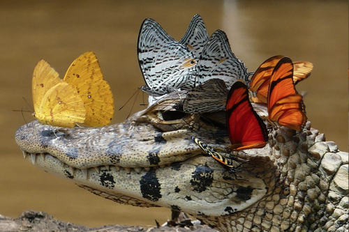

- gallium, temperature / seasons
- sphere: close: zurich (apartment issues, etc.); even smaller: ZHdK?
- ulysses pack: restrain / deconstruct itself once aware of it's powers
- communication / engraved artifact through material / language / archive
- take news / transcribed by robot
- abramovic: behvaiour of audience determines robot's actions
- soldiers getting detached to killing due to FPV drones / distancing through the machine
- step 1: high five, step 2: hand shake, step 3: caress, step XX: introduce pain / where is the limit / trust
- robot / machine that extracts humans to use for XY (e.g. human blood to draw / write / paint)
- robot arm as a physical extention of some other entity than humans (AI, plant, other organisms, etc.)
- robot as bio-lab scientist: given bacteria, etc. it is able to perform experients, paint on a canvas petri dish, etc.
- blood, tears, sweat: extracting tears after it made you cry through showing you specific algorithm-decided videos, used to do XYZ; 5 heads around the robot, positioned back to back. in a lab-like, sterile linimal space. displays in front of the humans. as soon as starts to cry, robot comes to collect tears
  - moth / butterfly that drink blood / tears
  - sweat beed
  - eye gnats
  - certain flies

