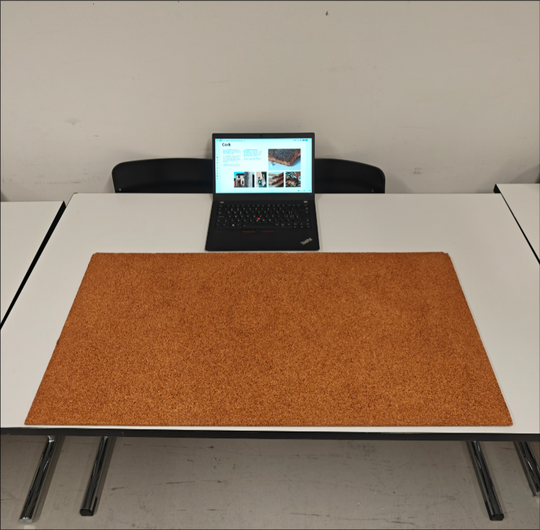

# cork - claudio

Used in a wide variety of industries and application, cork is one of the most versatile, natural materials. It's mostly known as a cork stopper to seal glass bottles.

For it's great thermal insulation properties as well as ability to shield vibrations, it's even used in the manufacturing of space crafts. "...as it is characterized by lightness, elasticity, impermeability, and fire resistance." (Wikipedia). Combined with cotton it also makes for a durable and elastic thread used for textiles.

Cork is harvested from the "cork oak" - [Quercus suber](https://en.wikipedia.org/wiki/Quercus_suber). It's the outer layer of it's bark. When extracted, the tree gets little to no harm and therefore is able to regenerate it's own bark. With a cycle of eight years, trees can be used to harvest bark for centuries. The biggest cork oak forest and therefore also the largest cork export country is Portugal.

# coconut oil - timon

tbd

# salt water - matthieu

tbd

# soap - dome

tbd

---

# collective experience - "saltcable"

tbd

&nbsp;

&nbsp;