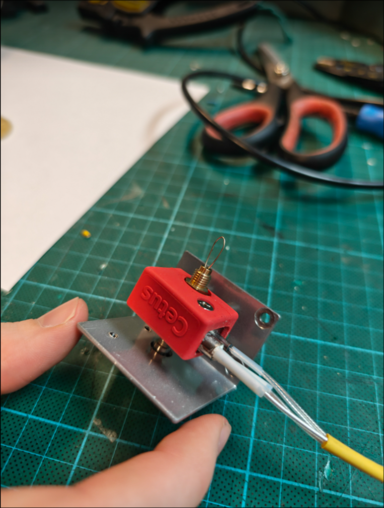
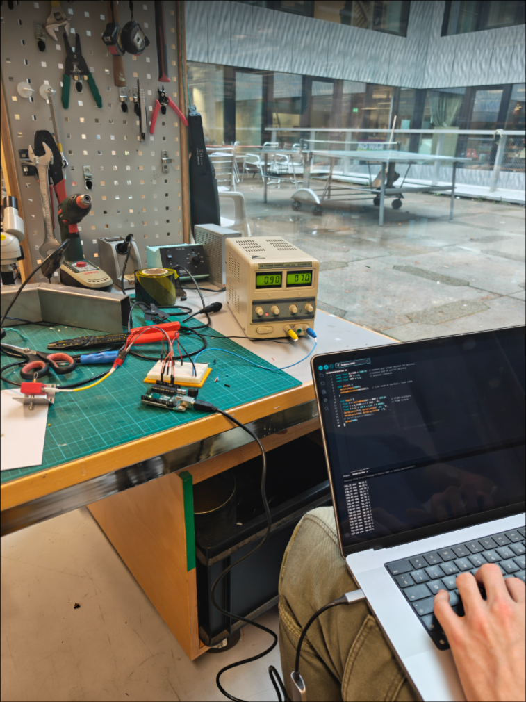
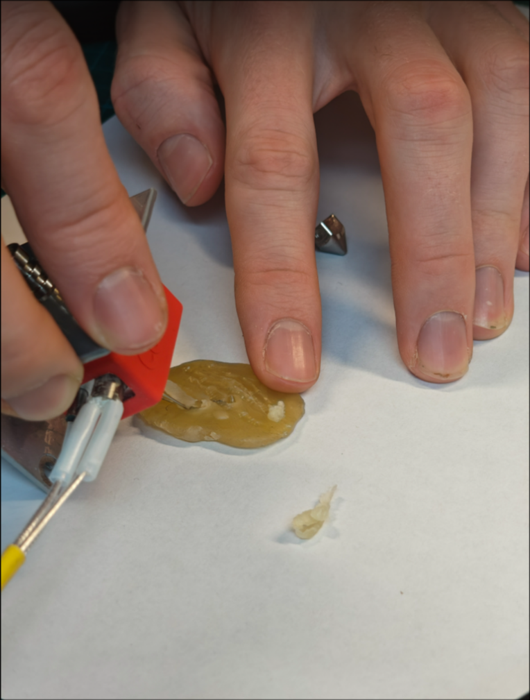

**Directions & Outcomes, after Input 10.11. Johannes**

- Robot engraves wax plate, based on XYZ
- XYZ being a selected, time-frame sensitive statistic / data source
- Once completed, the drawn canvas acts as a temportal, archived artifact haning on the wall
- During the exhibition, the canvas may melt, either manually triggered / by the audience, or through the data set, exceeding a certain threshold
- 3D printer heating bed below the wax canvas
- **borders are always changing and part of the place we live** 
- infrastructure : gaz, pipline, ormutz, internet cable (undersea?)
- environment : El Nino, river, forest, desert
- politics, how separate people are or connected

## Experimenting with melting wax

