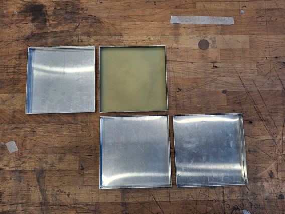
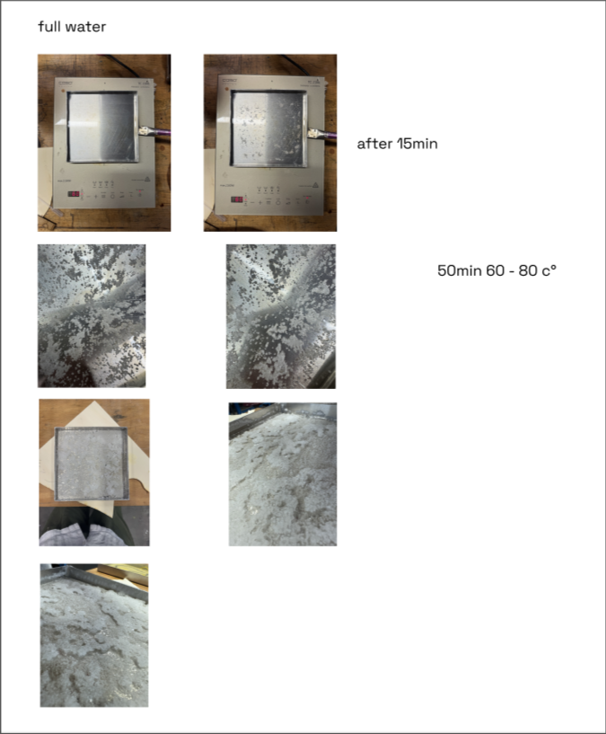

## Concept Summary

Internet communication runs through an infrastructure that is very materialistic. Physical subsea-internet cables connect continents and countries together. These traces remain static for most of the time. What is dynamic is what runs through those cables. Governments, agencies and institutions use this as a tool of power and control. By intercepting these cables, they constantly record what is being transmitted. A map gets drawn once the data becomes of interest to them.

By intercepting publicly accessible, unprotected webcam footage, we look at the constant stream of data through the eyes of a tool of control itself – the surveillance camera. Every time a person does action X[1](#sdfootnote1sym), we capture it. We capture the interest to the system in this moment of time. While seemingly completely arbitrary, this artifact represents the hidden logics of surveillance. The robot arm melts this frame into a plate of wax. The low resolution hereby is an intentional choice, one of data privacy.

Once the person does the action X, the old record gets melted. The temporal aspects of the wax allows this to happen. Our concept foresees an infinite, rotating structure containing 4 canvases made from wax.

The cycle is divided into 4 steps that are linked to action X.  

1.) Registered action X triggers the etching of the image into wax  
2.) The resulting visualization is displayed  
3.) The visualization is remelted, thus returned to it’s initial form  
4.) The wax is allowed to cool and hardened, thereby preparing it for it’s next cycle

Each time action X gets registered, the robot turns the turntable 90deg and starts to engrave the captured image into the new canvas.

Action X is also what defines the temporal aspect of each cycle, ergo the given duration of each step.

[1](#sdfootnote1anc) Action x is tbd (to be defined)

&nbsp;

#### *Materiality* - (paraffin) Wax

Using wax allows us to display temporal aspects of borders - the absurdity of drawing artificial lines onto maps that we collectively choose to accept and live by. While the lines are adapted and conquered, the material - the land, the soil, the water, remains the same. 

By engraving into a wax map and allowing for a system where it could melt at any time after it's creation - it becomes fragile. Once a map is melted, the borders fade and the material returns into it's untraced form, remaining it's essence.

&nbsp;

---

## Prototyping

