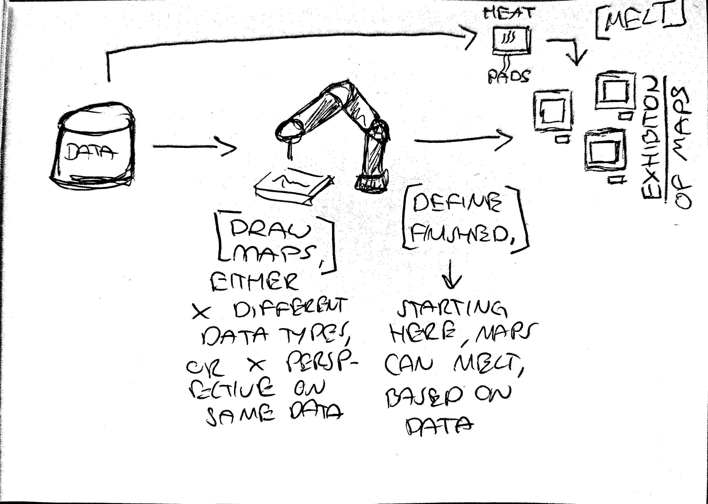

Questions that came up during today's input:

- Justify Bee wax / it's ethical implications
- Material should be chosen based on the data / map we want to draw (e.g. Paraffin for map regarding oil industry)
- Framing of the map matters: Power and historical aspect implied when framing something on a wall -> who draws the map, who is included, who isn't -> perspectives
- Level of detail / zoom -> focus on an aspect of a structure, system, route, etc. which then explains the bigger picture 
- Display the lines by using two differently colored layers of wax plates

