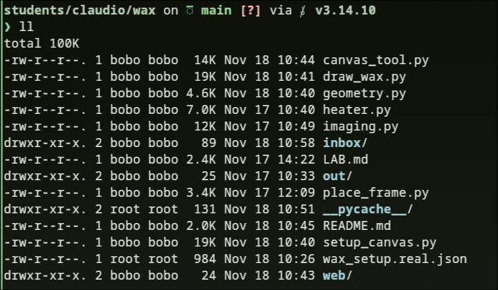
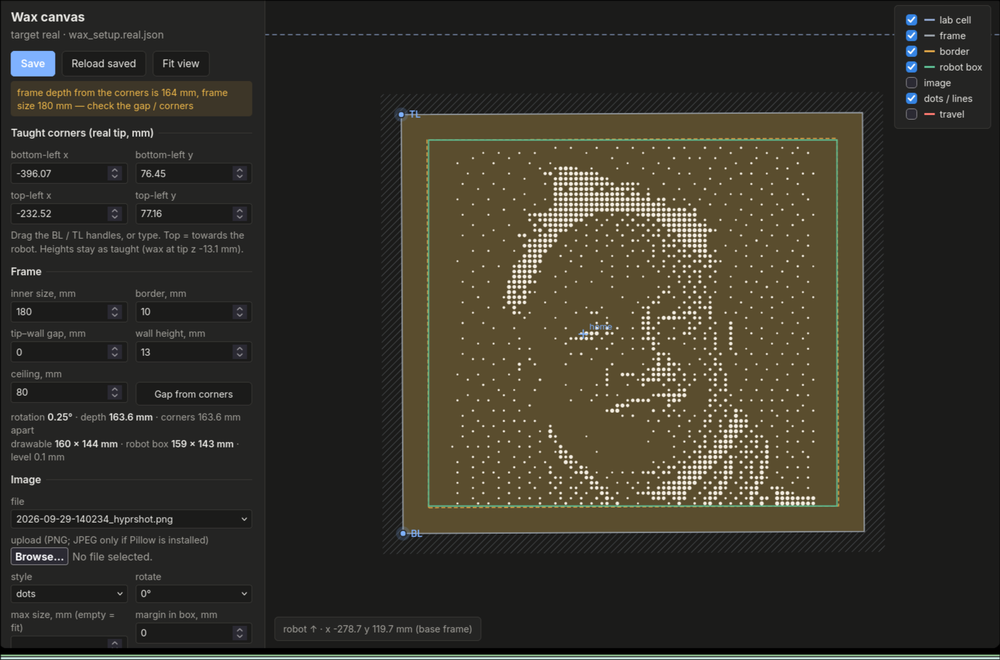

We've conducted first engraving simulations.

Currently, the script reads "image" files (.png) that are saved in the "inbox/" directory.



These then get abstracted into a dot style resolution, based on the brightness values captured within the image.  

Here are the first results when testing it in the simulation:  


it's possible to define the following parameters in order to adjust the resolution and output:

```
# draw_wax options the tool edits and saves into setup["draw"]
DRAW_KEYS = ("image", "style", "dot_mm", "gamma", "sharpen", "no_levels", "min_dark", "dwell_min",
             "dwell_max", "invert", "rotate", "mirror", "size_mm", "margin_mm", "hatch_mm", "threshold")
```

---

## From simulation to reality

We've built a frame that allows the canvas to sit at exactly the same spot every time. It's mounted directly on the M8 threads of the base table.  


Next, we had to provide the script and the installation definition with the correct coordinates, the position information of the canvas, the boundary for the drawing, the height for the travel of the tool, etc. For this, we generated a script which allowed us to read in the values step by step while connected to the robot over RJ45.  

[image setup script, tbd]


&nbsp;

We ran into some issues and limitations of the joint rotations. After some trial and error, we managed to locate all 4 corners of the canvas and set the right relations between them. An additional issue was that, at this point of the process, we still had the first iteration of our toolhead, which is offset from the center of the flange on the X axis. This meant that, depending on how the robot is oriented, there tool was positioned outside of the canvas frame. At this point, the second iteration where the tool is centered that Timon developed, was 3d printing. 


Additionally, we generated a graphical representation of the canvas and coordinates. This made it easier to adjust values like border to frame, wall height, etc.



