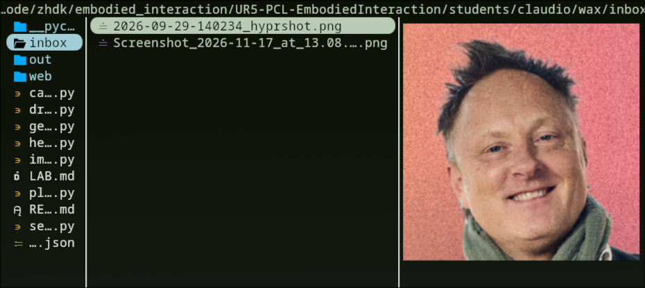
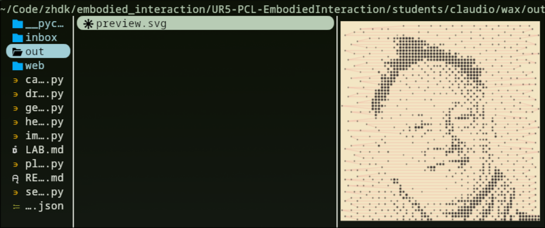
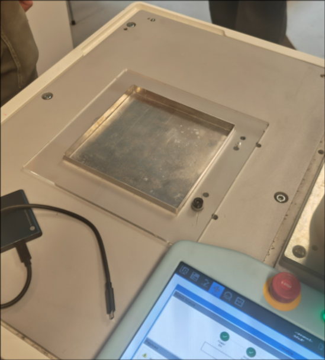
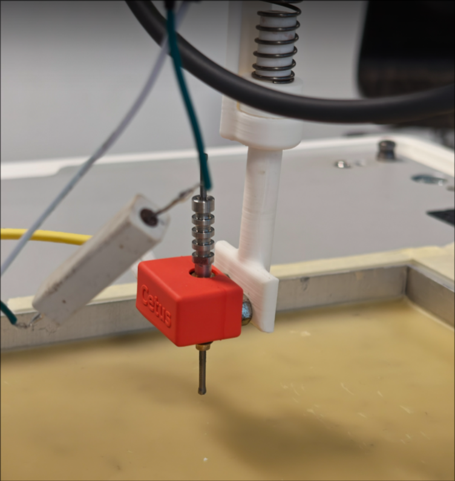
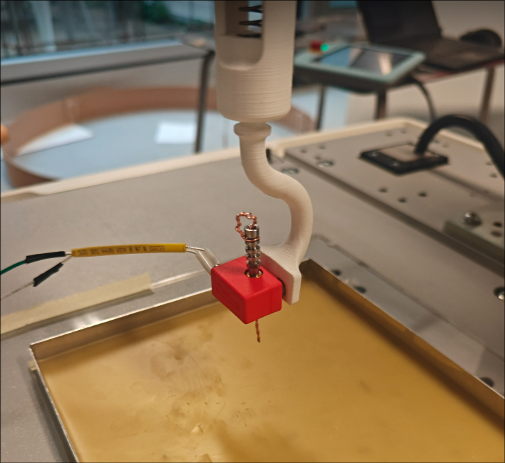
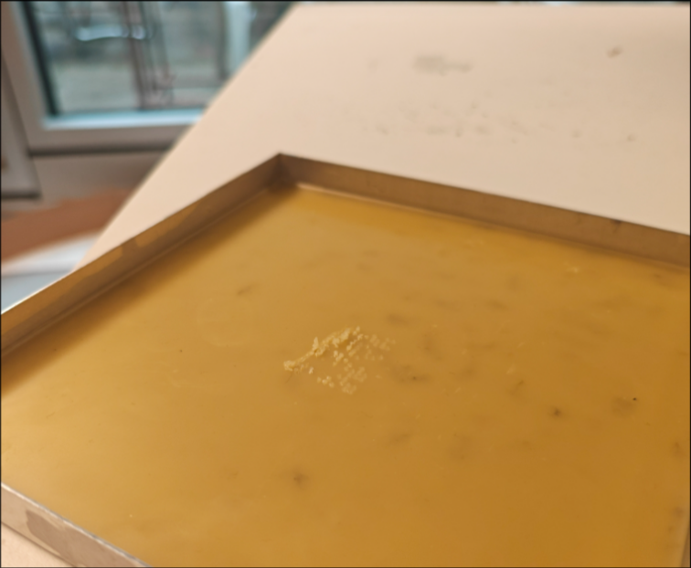
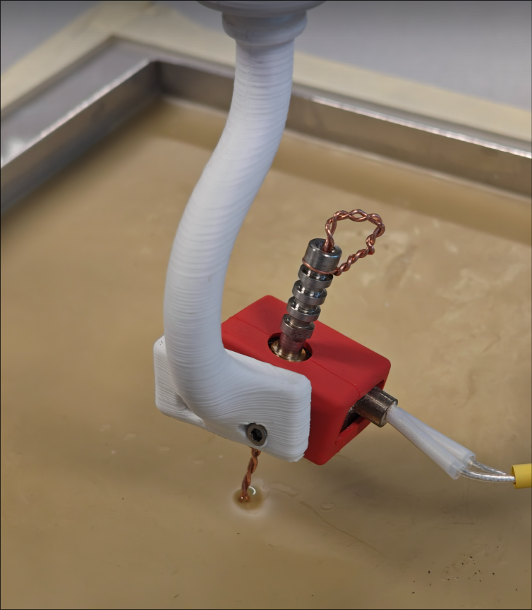
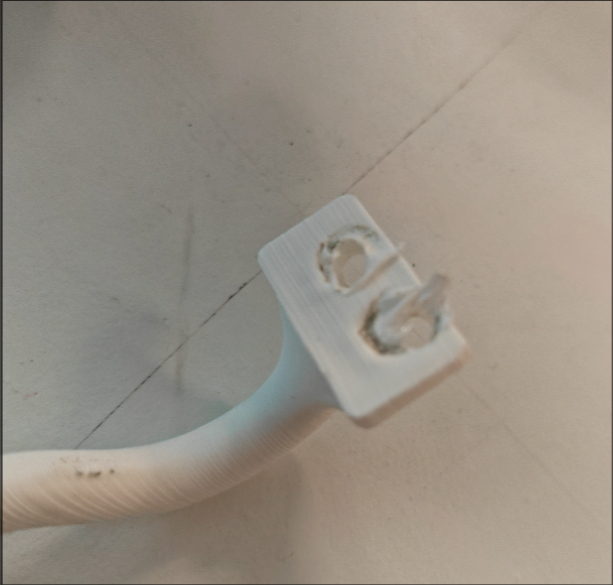

We've conducted first engraving simulations.

Currently, the script reads "image" files (.png) that are saved in the "inbox/" directory.


These then get abstracted into a dot style resolution, based on the brightness values captured within the image.  

Here are the first results when testing it in the simulation:  






it's possible to define the following parameters in order to adjust the resolution and output:

```
# draw_wax options the tool edits and saves into setup["draw"]
DRAW_KEYS = ("image", "style", "dot_mm", "gamma", "sharpen", "no_levels", "min_dark", "dwell_min",
             "dwell_max", "invert", "rotate", "mirror", "size_mm", "margin_mm", "hatch_mm", "threshold")
```

---

## From simulation to reality

We've built a frame that allows the canvas to sit at exactly the same spot every time. It's mounted directly on the M8 threads of the base table.  




Next, we had to provide the script and the installation definition with the correct coordinates, the position information of the canvas, the boundary for the drawing, the height for the travel of the tool, etc. For this, we generated a script which allowed us to read in the values step by step while connected to the robot over RJ45.  

[image setup script, tbd]


&nbsp;

We ran into some issues and limitations of the joint rotations. After some trial and error, we managed to locate all 4 corners of the canvas and set the right relations between them. An additional issue was that, at this point of the process, we still had the first iteration of our toolhead, which is offset from the center of the flange on the X axis. This meant that, depending on how the robot is oriented, there tool was positioned outside of the canvas frame. At this point, the second iteration where the tool is centered that Timon developed, was 3d printing. 




We made use of a ceramic resistor, since the 3D heater head draws around ~1.6 amps (max current - even on dual pin mode - is 2 amps for 1 sec, and 1.5 constant). However, the resistor got so hot that after some time, the solder points melted and we had to use an external power supply to continue testing.




With the new toolhead installed, we could proceed with the setup.

Additionally, we generated a graphical representation of the canvas and coordinates. This made it easier to adjust values like border to frame, wall height, etc.


---

## First engraving testing

After confirming, that each corner position is set correctly, we did a first dry run (no heat, not touching the wax yet) which completed successfully.


Now it was time to do a first real test (using a 30mm test drawing - simple dot arrangement).





After some initial errors (tool went do deep into the canvas, resulting in a bent tip), we managed to complete the first dot-test.

However, in the second iteration the toolhead started to heat up the screws to the point where the PLA started to melt.




This concludes our first physical engraving attempts. While there were some mistakes and accidents involved, we managed to verify the following:

- Canvas setup / coordinates mapped correctly
- The script is able to transform image to an appropriate resolution / dot format
- Homing, default positions, movements (correct joint placements and sequences) working
- Ceramic resistor (even though it got too hot; Johannes ordered a new one) works in order to bring down the current expected for the heater head; External power supply would work as a fallback


### Next Steps:

- **Improve tool head:** Heatsink, distance between PLA and metal parts, etc.
- **Implement buttons**: When button pressed, grab frame of webcam footage (script to scrape footage is already implemented)
- **Tune engraving** once toolhead is done: Depth, duration (how long to stay on one dot), speed, distance / gap between, etc.
- **Produce more frames**: and fill with wax

