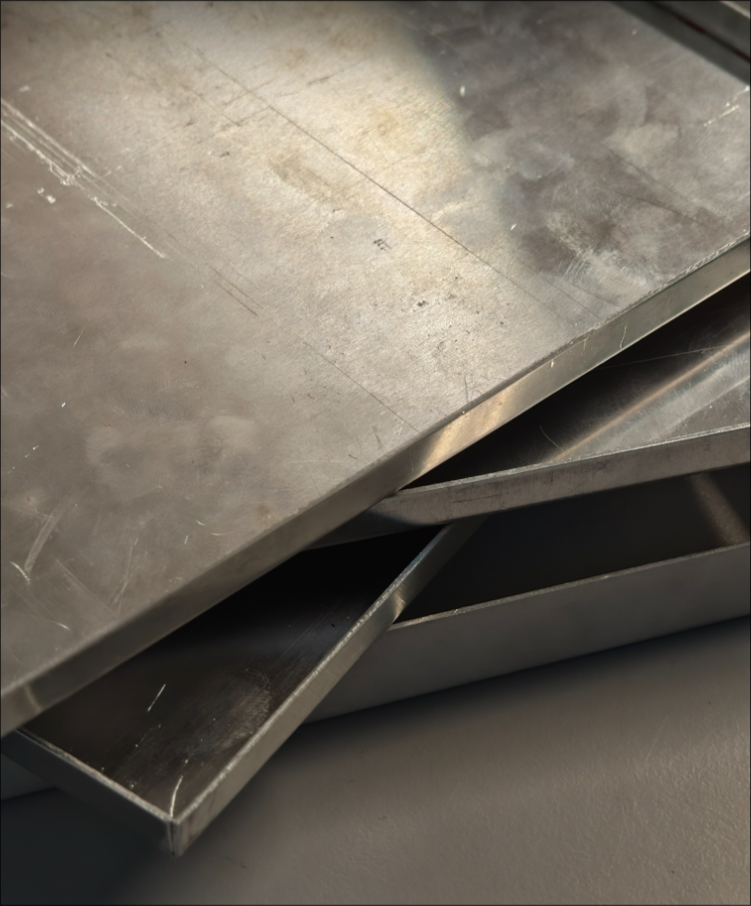

- Toolhead heat sink, tbd

**New frames**: we adjusted the wall height of the frames to be 7.0mm, so roughly half the height of the initial frames. this gives us more clearance for the toolhead and also improves aesthetic since less wax is needed to fill the frames

&nbsp;