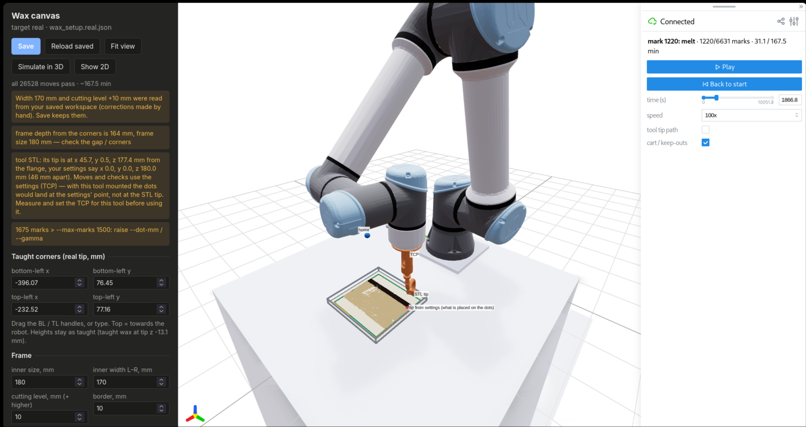

This updated web interface allows us to better simulate and adjust the engraved images. After configuring the resolution, radius and melt durations / speeds, it's possible to simulate and preview the precise movements done by the robot. The correct dimensions, measurements and toolhead are used to have a layer of control and abstraction.

The web implementation is part of our main github repo and can be served locally from there:

[https://github.com/bonjourclaudio/UR5-PCL-EmbodiedInteraction/tree/main/students/claudio/wax](https://github.com/bonjourclaudio/UR5-PCL-EmbodiedInteraction/tree/main/students/claudio/wax)

